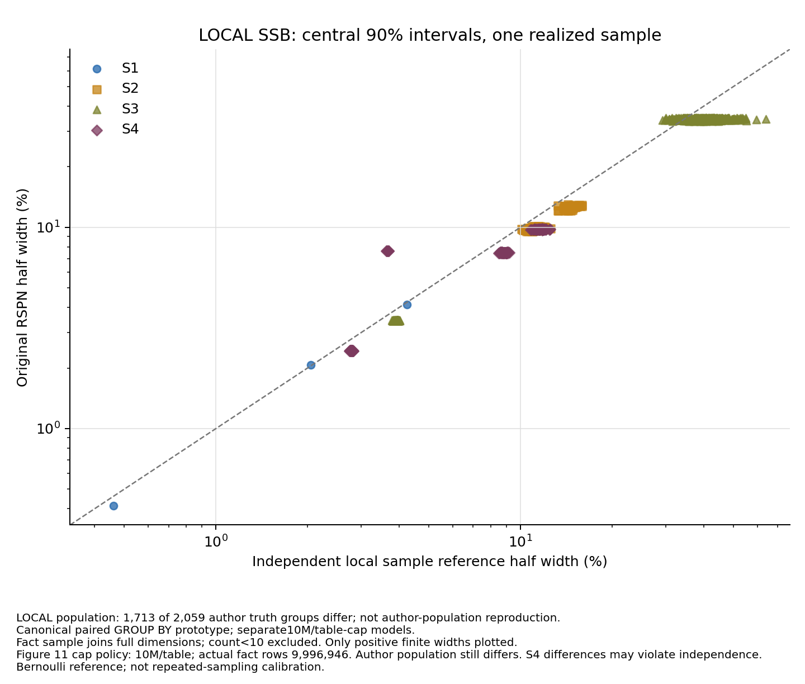

# DeepDB 论文复现 · DSC5003

Benjamin Hilprecht 等，**DeepDB: Learn from Data, not from Queries!**，VLDB 2020。
[论文](https://arxiv.org/abs/1909.00607) · [作者代码](https://github.com/DataManagementLab/deepdb-public) · [来源与适配](docs/UPSTREAM.md)

本仓库交付JOB-light基数估计、参数与增量实验、C++推理、Flights 1B、LOCAL SSB SF500的模型/AQP/CI，以及实际完成的比较方法和组员实验。**整篇论文仍未完成复现，`full_paper_complete=False`。** 作者输入缺失、本地母体差异和原规模数据库基线缺口保留，不用完成比例或作者历史数字替代本次实验。

代码和可公开结果的最终交付分支为 `main`；完整阶段整合与审查见 [PR #3](https://github.com/VictoriaSU551/DSC5003-DeepDB/pull/3)。31项主结果快照来源于 **2026-11-03** 的封存状态，当时没有 `EVIDENCE_INVALID` 项；**2026-11-04** 的[最终账本](output/results/final_delivery.json)另加入LOCAL Verdict SF500实际执行与完整验收。作者母体失败和输入缺口仍明确列出。

## 查看结果

- [最终交付说明](output/results/FINAL_DELIVERY.md) · [最终账本](output/results/final_delivery.json)
- [全部已验证阶段、表格和图片](output/results/FULL_PAPER_RESULTS.md) · [摘要与来源哈希](output/results/fullpaper_summary.json)
- [补充基线及SSB两种预算的实际调用和覆盖](output/results/fullpaper_additional_baselines.json)
- [详细状态](docs/FULL_REPRODUCTION_STATUS.md) · [运行指南](docs/FULL_RUNNING_GUIDE.md) · [四项作者公开输入缺口](docs/FINAL_PUBLIC_INPUT_GAPS.md)
- [guoao中文报告](output/results/guoao_experiments/report_zh.md) · [English report](output/results/guoao_experiments/report_en.md) · [组员协议、署名和核验边界](docs/TEAM_EXPERIMENTS.md)

| 已实际执行的内容 | 结果及适用范围 |
|---|---|
| JOB-light / PostgreSQL | 六张完整IMDb表，70条独立真值和PG11.5估计；100K存储配置、10M单表/RDC和两个schema分别保存。正文预算代理配置中位q-error1.344960、p95为4.313755，尾部未恢复作者结果。 |
| 泛化、参数和更新 | 公开683条分组查询，其中4–6表413条；1K至10M样本、B=0/.5/1/2/3、五个时间切点及增量恢复。作者200条成员仍缺；74个公开标签差异另存本地精确真值评分。 |
| C++ / MSCN | canonical C++执行753条×3次，7,422次实际native成功调用，Python/native/CSV逐条一致；官方MSCN与一致样本重建MSCN分别训练100轮，70/753条评估各自封存。 |
| Flights 1B | 实际遍历1,000,000,000行，保留9,997,912行样本；12SQL、331组；新鲜逆序24次point/CI调用一致。参考CI有322组可用、9组排除。 |
| LOCAL SSB 1M/table | 五个原模型的continuation复用已验收正向，另做逆序13次载入/26次调用；2,059点、4,118区间端点最大差0，历史失败保留。 |
| LOCAL SSB 10M/table cap | **另训练五个模型，正式验收、独立逆序及派生表图均通过**。事实表实际9,996,946行；逆序13次模型载入/26次调用，2,059点、4,118端点最大差0；参考CI1,253组可用，806组因样本少于10行排除。 |
| 其他实际比较方法 | Scalar本地变体、SRS/IBJS各70条；DBEst原引擎的Flights部分覆盖及单维路由；Flights Verdict已有样本执行。原零估计、缺组、不支持项和原错误保留，见[补充结果](output/results/fullpaper_additional_baselines.json)。 |
| LOCAL Verdict SF500 | 五表导入、注册及38次原始物理调用完成；样本缩放和独立完整验收通过，26行RAW/6行外部双SUM点适配另列。原错误和缺组保留，见[最终交付](output/results/FINAL_DELIVERY.md)。 |

SSB本地母体3,000,028,242行，与作者行数一致，但2,059项作者真值中 **1,713项customer连接真值不同**。LOCAL模型按同一生成母体的独立精确真值评分，作者母体门禁仍失败。两种SSB模型共享实际样本参考，不构成重复抽样CI校准，也不把训练上限写成恰好10M事实行。



完整3B事实表的普通数据库基线、原表建样本、XDB等原规模比较尚未执行，见[资源可行性说明](docs/FULL_BASELINE_FEASIBILITY.md)。Flights Verdict仅运行已有样本，原生95%CI与DeepDB中央90%CI分开报告；DBEst部分SQL/20K拟合及本地路由不构成完整Figure13或等预算延迟排名。

guoao的贡献署名为 `breck1016`，原提交、文件和归属保留。其14组JOB-light设置、980个预测、多种子RDC/基础模型和PG16.15比较独立保存，不与扩展实验的PG11.5、schema或随机化协议混算。结论及复训交接条件见 [TEAM_EXPERIMENTS.md](docs/TEAM_EXPERIMENTS.md)。

## 离线阅读与重新运行

克隆后可直接阅读公开CSV、PNG、报告和JSON，不需要下载数据或模型。组员包还有Python标准库只读核验入口：

```powershell
python -B output/results/guoao_experiments/verify_results.py --repo-root .
python -B output/results/guoao_experiments/verify_evidence.py
```

从数据重跑基础JOB-light流程，使用Windows PowerShell、Git、curl、uv及固定Python3.8.20环境：

```powershell
git clone https://github.com/VictoriaSU551/DSC5003-DeepDB.git
Set-Location DSC5003-DeepDB
powershell -ExecutionPolicy Bypass -File setup.ps1
.venv/Scripts/python.exe -B code/download_data.py
.venv/Scripts/python.exe -B -m pytest code/tests/test_learning.py code/tests/test_preparation.py
.venv/Scripts/python.exe -B code/reproduce.py all
.venv/Scripts/python.exe -B code/verify_results.py
```

`all`运行六表预处理、五个关系RSPN训练和70条评估；已有匹配模型会复用。原始六表约2.81GB，预处理另需空间。这不会自动重跑全部扩展实验或恢复组员13轮训练。扩展数据、MSCN环境、数据库及科学执行门禁按[运行指南](docs/FULL_RUNNING_GUIDE.md)分别准备。完整测试目录包含真实生成器、原生编译和数据库门禁，日常按改动选择纯/合成测试，不直接运行整个目录。

## 文件与交付边界

```text
code/                 固定作者算法、适配、执行/核验入口、SQL和测试
docs/                 协议、状态、差异、来源缺口和运行说明
data/                 下载/生成的数据；数据本体不随GitHub分发
output/results/       可公开表、图、报告和来源摘要
output/full/          本地科学运行、模型、完整证据闭包和派生输出
```

GitHub发布代码和审查后的共享结果；大型权重、数据/HDF、环境、数据库、PDF和凭据不提交。新机器需要下载或生成数据并建立环境，清单不等于模型本体随仓库交付。作者算法固定于 `655ada13a043a4226a239b0c0a65bcdefef87a02`，MIT许可证及来源说明保留。

本地最终交付目标为 `README.md`加 `results/`结果包，具体保留文件以最终清单为准；实际精简与清理状态见[清理凭据](output/results/cleanup_status.json)。若精简移除历史运行闭包，相关完整来源验收入口须明确退役，结果快照不能冒充仍可现场完整复核。新实验另建目录，不覆盖已验证结果。协作规则见 [CONTRIBUTING.md](CONTRIBUTING.md)。
