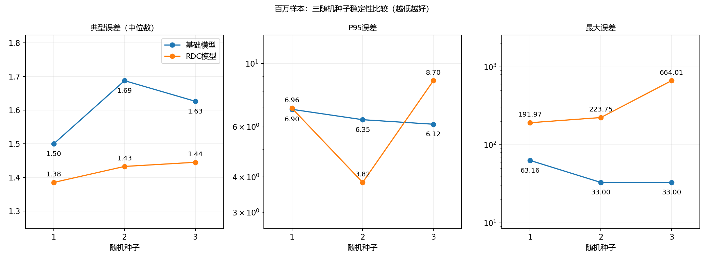

# DeepDB 论文复现 · DSC5003

论文：Benjamin Hilprecht 等，**DeepDB: Learn from Data, not from Queries!**，VLDB 2020。

[论文](https://arxiv.org/abs/1909.00607) · [作者代码](https://github.com/DataManagementLab/deepdb-public) · [源码来源与适配](docs/UPSTREAM.md)

本仓库汇总 DeepDB 的本地复现和小组实验。**JOB-light 基础流程及组员的扩展结果已整理到 `main`；整篇论文仍未完成复现。** 2026-11-03 的同步核验通过了 14 组设置、980 个保存预测的指标重算、70 条查询对齐和证据包完整性检查。本次整理未重新训练或执行数据库查询。

## 直接查看结果

- [组员中文图文报告](output/results/guoao_experiments/report_zh.md) · [English report](output/results/guoao_experiments/report_en.md)
- [实验汇总、协议差异与核验边界](docs/TEAM_EXPERIMENTS.md)
- [14 组完整指标](output/results/guoao_experiments/metrics.csv) · [70 条逐查询预测](output/results/guoao_experiments/predictions.csv)
- [全部真值核验记录](output/results/guoao_experiments/truth_audit.csv) · [配置](output/results/guoao_experiments/settings.json)
- [逐轮运行与日志索引](output/results/guoao_experiments/DELIVERY_MAP.md) · [本次同步核验记录](output/results/guoao_integration_audit.json)
- [最初的 1M 关系基础模型结果](output/results/RESULTS.md)

组员 guoao 的贡献提交署名为 `breck1016`，来源为 [`contribution/guoao-experiment-results`](https://github.com/VictoriaSU551/DSC5003-DeepDB/tree/contribution/guoao-experiment-results)。原提交、36 个交付文件和作者许可证均保留。

## 已完成的 JOB-light 实验

六张完整 IMDb 表、同一套 **70 条不同 SQL**：9 轮关系基础模型训练（1万/10万/100万样本预算 × 种子1/2/3），4 轮 RDC 训练（10万预算种子1；100万预算种子1/2/3），加一组 PostgreSQL 16.15 估计，共 **14 组评估设置、980 个预测值**。16 张中英文图片对应 8 类图表，不作为新增实验计数。

下表摘录百万预算及 PostgreSQL 的结果；q-error 越接近 1 越好。

| 设置 | 中位 q-error | P95 | 最大 q-error |
|---|---:|---:|---:|
| 关系基础模型，种子1 | 1.4997 | 6.9010 | 63.1645 |
| RDC，种子1 | 1.3847 | 6.9630 | 191.9660 |
| 关系基础模型，种子2 | 1.6874 | 6.3468 | 33.0000 |
| RDC，种子2 | 1.4322 | 3.8232 | 223.7538 |
| 关系基础模型，种子3 | 1.6261 | 6.1186 | 33.0000 |
| RDC，种子3 | 1.4446 | 8.6999 | 664.0056 |
| PostgreSQL 16.15 | 8.6874 | 842.7846 | 3606.4054 |

RDC 在三个种子下分别改善 42、44、42 条查询，中位误差三轮均降低；P95 仅一轮改善，最大误差三轮均增大。基础模型每轮 5 个 RSPN，RDC 每轮 7 个，请求样本预算按每个 RSPN 计；两条流程的连接规模来源也不同。它们是两条配置流程的对照，不能把全部差异只归因于 RDC，也不构成等总预算或 SQL 执行提速的结论。



70 条保存的独立计数全部匹配官方答案：69 条使用原始 SQL，ID59 使用等价的精确分组计数，并以 ID0、14、34、57 的原始执行结果交叉检查。这是组员已完成并交付的数据库实验；本次同步核验的是保存记录、SQL 哈希和数值，未在本机重新执行这些 SQL。

## 无需下载数据的离线核验

从仓库根目录运行，Python 标准库即可：

```powershell
python -B output/results/guoao_experiments/verify_results.py --repo-root .
python -B output/results/guoao_experiments/verify_evidence.py
```

第一条重算误差、检查 980 个预测及 70 条 SQL/官方计数对齐；第二条核验公开文件、37 段选定日志、源码快照和模型清单的指纹对应。两条命令均应输出 `"status": "PASS"`，不会训练、连接数据库或写入结果。模型清单核对不等于重新加载模型；13 个模型本体未包含在 GitHub 中。

## 文件布局与分支

```text
Deep DB/
  code/                          作者算法、基础复现脚本和基准 SQL
  data/                          原始及最终处理数据；数据本体留在本地
  output/
    models/                      本地模型
    results/
      guoao_experiments/         组员的原始交付包：表格、图、报告、压缩日志和源码取证
      guoao_integration_audit.json  本次同步与离线核验摘要
  docs/                          来源、协议、协作和实验详细说明
```

- `main`：基础复现流程和已同步的 JOB-light 组员结果，作为小组阅读入口。
- [`reproduction/full-paper`](https://github.com/VictoriaSU551/DSC5003-DeepDB/tree/reproduction/full-paper)：扩展复现代码及各阶段结果，包括参数实验、Flights、SSB 和其他基线；尚未完成整篇论文。详见该分支的[详细状态](https://github.com/VictoriaSU551/DSC5003-DeepDB/blob/reproduction/full-paper/docs/FULL_REPRODUCTION_STATUS.md)与[运行指南](https://github.com/VictoriaSU551/DSC5003-DeepDB/blob/reproduction/full-paper/docs/FULL_RUNNING_GUIDE.md)。组员这批 70 查询结果不与扩展分支的其他工作负载、数据库版本和随机化协议混算。
- `contribution/guoao-experiment-results`：保留的组员贡献分支；两个原始提交已纳入主线历史。

## 从数据重跑基础流程

Windows PowerShell，使用 Git、curl、uv 和 Python 3.8.20；固定环境见 `requirements-lock.txt`。

```powershell
powershell -ExecutionPolicy Bypass -File setup.ps1
.venv/Scripts/python.exe code/download_data.py
.venv/Scripts/python.exe -m pytest
.venv/Scripts/python.exe code/reproduce.py all
.venv/Scripts/python.exe code/verify_results.py
```

`all` 运行六表预处理、每个关系请求 1M 样本的五个 RSPN 训练及 70 查询评估；已有模型时会复用。原始六表约 2.81GB，下载包约 1.26GB，预处理另需空间。只重评已有模型可运行 `code/reproduce.py evaluate`，无需 HDF。不同设置使用独立目录，保留已验证结果。

上述命令重跑基础流程，**不会自动恢复组员全部 13 轮训练**。组员的模型本体、HDF、完整环境和数据库仍需另外交接；ZIP 中是历史驱动与适配源码取证，不是解压即用的完整训练包。恢复条件详见[详细说明](docs/TEAM_EXPERIMENTS.md)。

## 来源与协作

作者算法固定提交 `655ada13a043a4226a239b0c0a65bcdefef87a02`，保留 MIT 许可证。小组基础流程负责 Windows 兼容、数据来源和模型重放；guoao 补充多预算/多种子训练、RDC 流程、PostgreSQL 对照、真值核验、图文报告和交付证据。本次同步负责主线整合、数值及包完整性复核和文档整理，不计为新增训练。

按 [CONTRIBUTING.md](CONTRIBUTING.md) 使用独立分支和 Pull Request 协作。GitHub 发布代码、必要核验工具及可共享结果；数据、模型、环境、PDF 和凭据留在本地。后续新增结果使用新的目录和运行编号，不覆盖已核验交付包。
