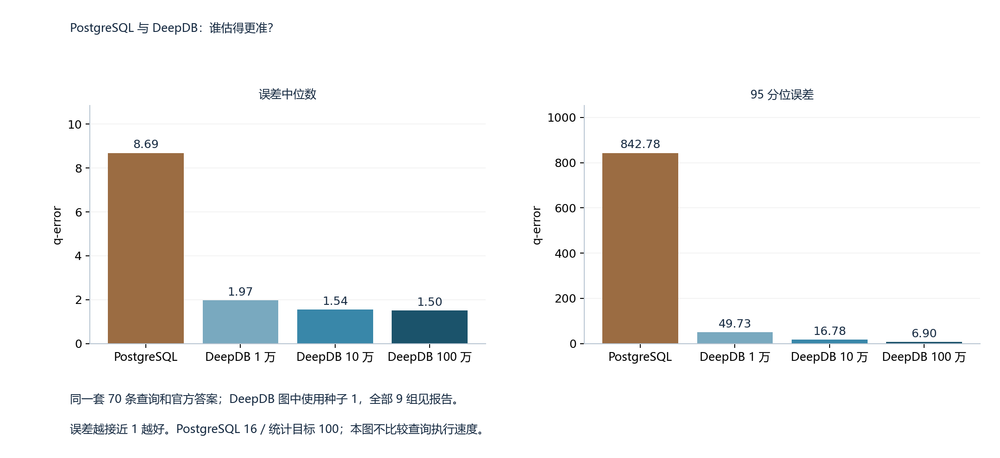
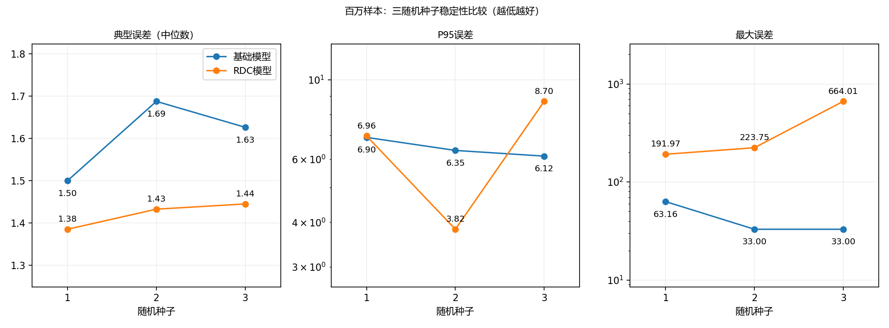

# JOB-light local experiments / 本机实验结果


## 展示入口 / Presentation

- [中文图文实验报告](report_zh.md) · [English experiment report](report_en.md)
- [实验配置 / Settings](settings.json) · [指标 / Metrics](metrics.csv) · [逐条预测 / Predictions](predictions.csv) · [真值核验 / Truth audit](truth_audit.csv)
- 8类图，各有中英文版本；对应同一批实验，不把语言版本计为新增实验。

| PostgreSQL 对照 / Accuracy comparison | RDC 三种子 / Seed stability |
|---|---|
|  |  |

完整图表与解释在中英文报告中；表格、预测和核验脚本位于本目录。

## 中文

本目录是基于作者算法和本仓库基础流程完成的实验结果记录：基础关系模型9轮（1万/10万/100万样本 × 种子1/2/3），以及RDC模型4轮（10万样本种子1、100万样本种子1/2/3）。RDC采用 `rdc_spn_selection` 推断。本目录另含一组PostgreSQL估计，共14个评估设置，始终是同一套70条不同查询。

- `metrics.csv`：14组指标、训练子进程耗时、模型与原始结果CSV指纹。
- `predictions.csv`：70条查询的真实数量和全部14组逐条估计；用SQL哈希对齐仓库查询集，避免重复存储SQL。
- `truth_audit.csv`：从本地数据重新计数的核验摘要，69条原始SQL直接成功，ID59采用等价精确分组计数。
- `verify_results.py`：仅依赖Python标准库，重新计算全部误差及三种子胜负数；可与仓库SQL和官方计数再对齐。

### 设置与来源

数据是作者README所引用的CWI IMDb/JOB快照的六张完整表，约2.81GB。数据包SHA256：`25f9d893c54f903366e0c263f88db0d429dbc2b159d4987ebc1e203242a7e988`。训练使用数据，不使用测试查询的正确答案；SQL与官方计数见[仓库基准](../../../code/benchmarks/job-light/sql/)。Python 3.8.20，依赖参见[锁定清单](../../../requirements-lock.txt)。

基础模型每轮5个RSPN；RDC每轮7个RSPN，请求样本量是每个RSPN的行数，总训练预算不相等。RDC预算系数5、最多3个连接、RDC搜索1万样本、1万个候选集合、学习阈值0.3、集合选择阈值0.15、`max_variants=1`；`post_sampling_factor=10 10 5 1 1`。全局NumPy/Python训练种子为1/2/3，评估种子1、`PYTHONHASHSEED=1`；RDC三轮固定同一份种子1的1万行预采样，作者内部固定随机种子保持不变。种子编号一致不代表不同方法使用了完全相同的训练行。

PostgreSQL 16.15：六表导入后建立主键及连接键索引并运行ANALYZE，统计目标100、无扩展统计，关闭并行估计和JIT。估计取COUNT顶层Aggregate下方输入节点的Plan Rows；不是Aggregate自身固定的1行。本目录比较估计准确度，不比较SQL实际执行速度。训练耗时来自不同历史运行，也不是严格受控的速度对比。

### 结果

q-error=`max(预测/真值, 真值/预测)`，越接近1越好。分位数采用线性插值。

| 设置 | 中位数 / Median | P95 | 最大值 / Max |
|---|---:|---:|---:|
| relationship_10000_s1 | 1.9701 | 49.7339 | 2600.6137 |
| relationship_100000_s1 | 1.5422 | 16.7784 | 190.7942 |
| relationship_1000000_s1 | 1.4997 | 6.9010 | 63.1645 |
| relationship_10000_s2 | 1.8788 | 32.6268 | 344.8353 |
| relationship_100000_s2 | 1.5761 | 7.8309 | 33.1974 |
| relationship_1000000_s2 | 1.6874 | 6.3468 | 33.0000 |
| relationship_10000_s3 | 1.8904 | 151.6677 | 3024.5007 |
| relationship_100000_s3 | 1.5514 | 7.4752 | 33.0000 |
| relationship_1000000_s3 | 1.6261 | 6.1186 | 33.0000 |
| rdc_100000_s1 | 1.4221 | 42.6988 | 2386.6428 |
| rdc_1000000_s1 | 1.3847 | 6.9630 | 191.9660 |
| rdc_1000000_s2 | 1.4322 | 3.8232 | 223.7538 |
| rdc_1000000_s3 | 1.4446 | 8.6999 | 664.0056 |
| postgresql | 8.6874 | 842.7846 | 3606.4054 |

百万样本RDC在三个种子下分别有42、44、42条查询更准，中位误差三轮都改善；P95只在一轮改善，最大误差三轮都更大。结论是典型表现改善、尾部仍不稳定。不能据此宣称全面更准或实际SQL执行加速。种子1/百万样本基础结果是对仓库已有结果的本机重跑，不是新的精度突破。

### 真值核验边界

70条计数全部与官方值匹配。ID59的等价精确分组SQL见下方；这种方法先按电影编号计算各子表行数，再对同一电影的数量乘积求和，不采用独立性估计。已在ID0、14、34、57的原始SQL实际执行结果上交叉核对一致。完整运行/重试日志与模型文件保留在本机，本目录只提供精简核验记录。

本次新增的是实验结果和数值核验，不是核心算法重新实现，也不是完整论文复现。基础流程与RDC流程的连接规模来源分别为元数据估算和按作者入口取得的数据库精确内连接计数，因此是两条流程的比较，不能把全部差异只归因于RDC。本目录补充8类已有图表的中英文版本及结果分析；普通greedy推断消融、完整日志、原始数据、模型、凭据与端到端重训练脚本仍留在本机。`verify_results.py`核验保存的数值，不会训练或重新执行数据库查询。

作者来源：[DeepDB](https://github.com/DataManagementLab/deepdb-public)，固定提交 `655ada13a043a4226a239b0c0a65bcdefef87a02`；本仓库基础版本 `ac2485496157092bcdbe85f61e18db216168566e`。源码来源和适配见[UPSTREAM](../../../docs/UPSTREAM.md)。本目录保留作者与组员已有工作的来源区分。

## English

This compact result archive contains nine relationship-baseline training settings and four RDC training settings, plus a PostgreSQL 16.15 estimation baseline: 14 evaluation settings over the same 70 distinct JOB-light queries. RDC results use RDC-based SPN selection; greedy-mode ablations remain in the full local records.

Data: the six full IMDb/JOB tables from the author-linked CWI snapshot. The archive hash and version/configuration details are recorded above. Models learn from database data, not labeled test queries. Requested training rows are per SPN; baseline ensembles contain 5 SPNs and RDC ensembles 7. Total training budgets therefore differ. Global search/training seeds vary. RDC reuses the seed-1 10K pre-sample; inference seed 1, the Python hash seed, and author internal fixed seeds remain fixed. Matching seed labels do not imply matching training samples across methods.

RDC uses budget factor 5, at most 3 joins, 10K search samples and 10K candidates; learning/selection thresholds 0.3/0.15 and max_variants 1. PostgreSQL uses ordinary statistics with target 100, primary/join-key indexes, ANALYZE, no extended statistics, and disabled parallel estimation/JIT. COUNT input Plan Rows are compared, not the aggregate output row count. Historical training times are not controlled runtime benchmarks.

At 1M samples, RDC improves 42, 44 and 42 queries respectively and has lower median error in all seeds, lower P95 in only one seed, and worse maximum error in all seeds. This supports typical-query improvement with unresolved tail failures, not overall dominance or actual SQL execution speedup. The seed-1 1M baseline repeats the repository's existing accuracy.

All 70 recomputed counts match the official reference: 69 original SQL successes plus query 59 by exact equivalent grouped aggregation, cross-checked on four executed original queries. The saved-count table and query hashes permit alignment and numerical checks; full logs and large artifacts remain local. The SQL below records the query-59 exact calculation.

This is an experiment-results contribution, not an independently reimplemented core algorithm or full-paper reproduction. Author algorithms and the teammate pipeline are retained. The baseline and RDC author paths use metadata-estimated and exact database join sizes respectively, so differences cannot all be attributed to RDC selection alone. This directory includes bilingual reports, settings, and eight figure topics in Chinese and English. End-to-end retraining scripts, raw data, model binaries, full logs and private machine information remain local. The verifier checks saved results; it does not train or execute database queries.

## Offline verification / 离线核验

From the repository root (standard-library Python is sufficient):

```powershell
python output/results/guoao_experiments/verify_results.py --repo-root .
```

For numerical checks without a repository checkout, run `python verify_results.py` beside the CSV files. Without `--repo-root`, benchmark-file alignment is not checked. The verifier writes no files.

## Exact grouped SQL for query 59

```sql
WITH exact_titles AS (SELECT t.id FROM title t WHERE t.production_year>2000),
exact_g0 AS (SELECT mi.movie_id, COUNT(*)::numeric AS n FROM movie_info mi WHERE mi.info_type_id=16 GROUP BY mi.movie_id),
exact_g1 AS (SELECT mc.movie_id, COUNT(*)::numeric AS n FROM movie_companies mc GROUP BY mc.movie_id),
exact_g2 AS (SELECT ci.movie_id, COUNT(*)::numeric AS n FROM cast_info ci WHERE ci.role_id=2 GROUP BY ci.movie_id),
exact_g3 AS (SELECT mk.movie_id, COUNT(*)::numeric AS n FROM movie_keyword mk GROUP BY mk.movie_id)
SELECT COALESCE(SUM(exact_g0.n * exact_g1.n * exact_g2.n * exact_g3.n),0) FROM exact_titles exact_t JOIN exact_g0 ON exact_g0.movie_id=exact_t.id JOIN exact_g1 ON exact_g1.movie_id=exact_t.id JOIN exact_g2 ON exact_g2.movie_id=exact_t.id JOIN exact_g3 ON exact_g3.movie_id=exact_t.id;
```
