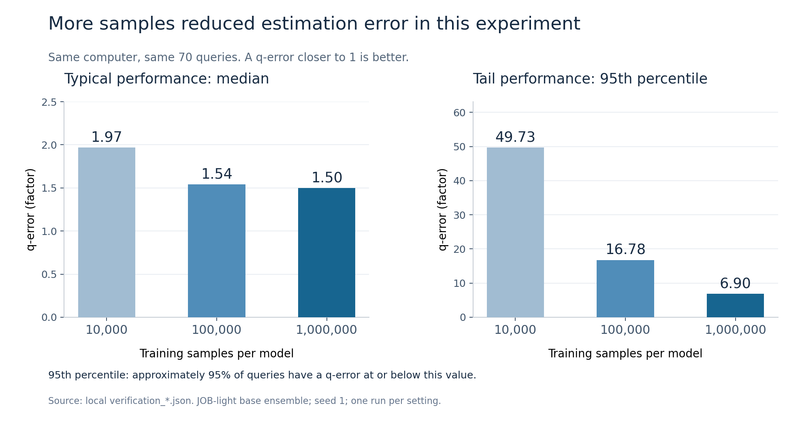
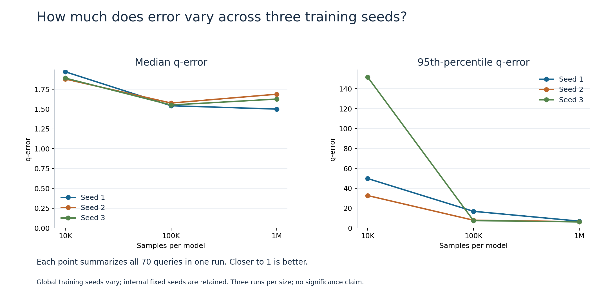
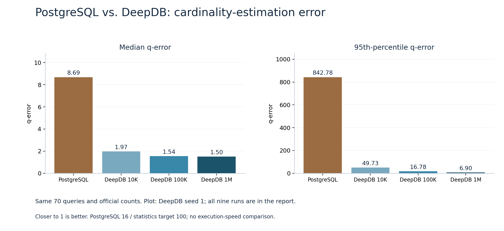
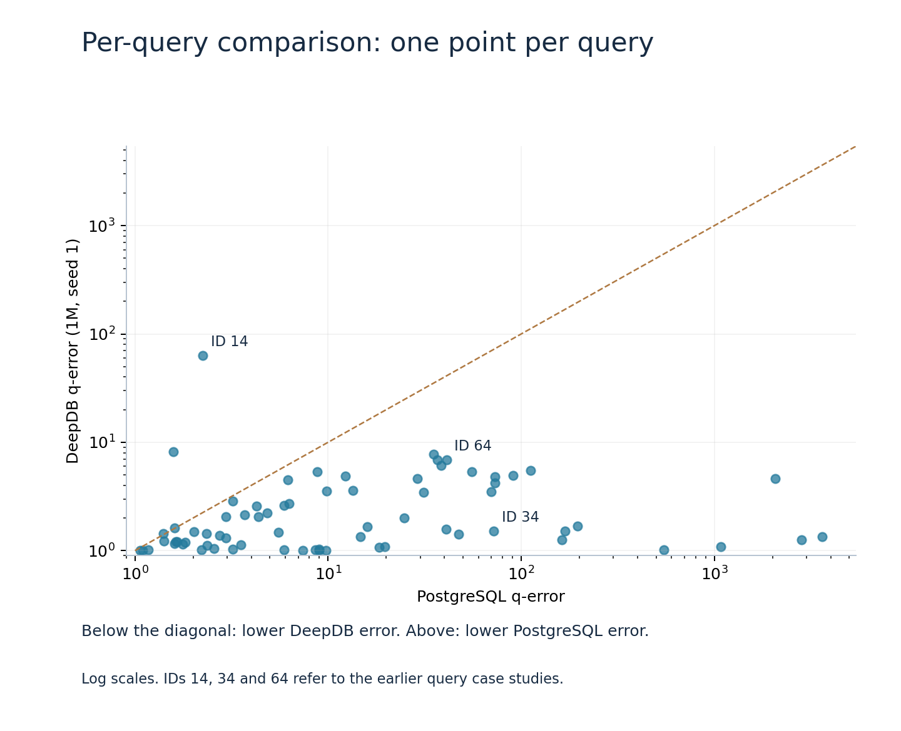
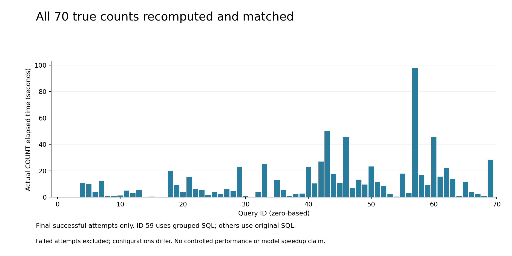
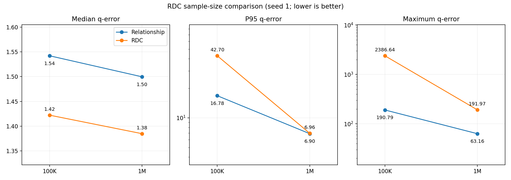
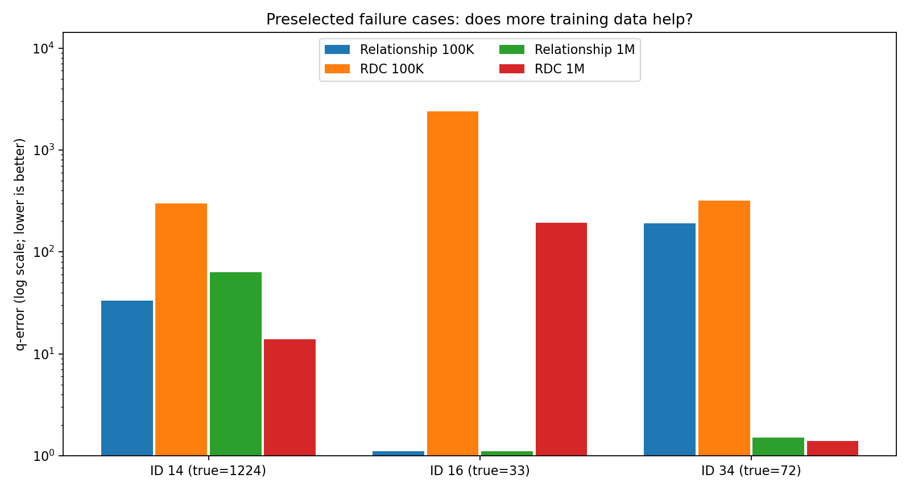
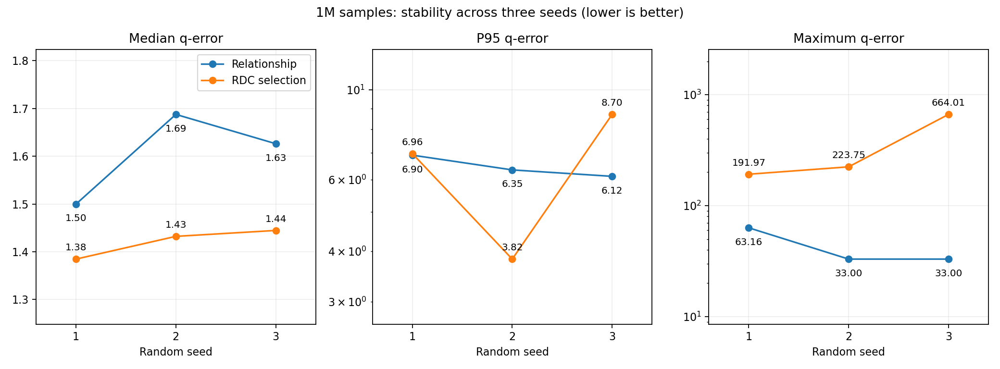

# JOB-light experiment results and analysis

The archive covers nine baseline and four RDC training runs plus one PostgreSQL estimation baseline, all using the same 70 queries. The eight figure topics have Chinese and English versions; language variants are not additional experiments.

## 1. Sample size: does more training data help?

The figure shows the seed-1 relationship baseline. From 10K to 100K to 1M requested rows per SPN, median q-error is about 1.97, 1.54 and 1.50; P95 is about 49.73, 16.78 and 6.90. This run improves overall, but not every individual query necessarily improves.

## 2. Seed repetitions: sensitivity to randomness

The baseline matrix contains three sample sizes and three global seeds. Median error improves from 10K to 100K in every seed. From 100K to 1M it worsens slightly in two seeds, while P95 improves in all three. Sample-size effects must therefore be evaluated metric by metric.

## 3. PostgreSQL: a conventional estimation baseline

PostgreSQL median/P95 q-error is 8.6874/842.7846. The seed-1 1M relationship baseline has 1.4997/6.9010 and lower error on 66 of 70 queries. Other DeepDB sample sizes in the first plot also use seed 1. Each point in the second plot is a query; points below the diagonal favor DeepDB. These are estimation-accuracy comparisons, not SQL execution-speed measurements.

## 4. Ground truth: recomputing all 70 counts

All 70 recomputed counts match the official reference: 69 original SQL successes and query 59 by equivalent exact grouped aggregation, cross-checked on four executed original queries. The plot contains only final successful attempt times, excluding failed retries. Settings differ across attempts and query 59 uses different SQL, so this is a process record rather than a query-performance ranking or model-speedup benchmark. See truth_audit.csv and the query-59 SQL in README.

## 5. RDC: increasing the training sample size

For seed 1, with the same pre-sample, pairwise RDC values and selected table sets, increasing requested samples per SPN from 100K to 1M changes median error from 1.4221 to 1.3847, P95 from 42.6988 to 6.9630, and maximum error from 2386.6428 to 191.9660. Tail errors improve, but comparisons with the corresponding baseline remain necessary. RDC has seven SPNs versus five baseline SPNs, so total training work differs.

## 6. Query cases: improvements and unresolved failures

The cases analyzed here are IDs 14, 16 and 34 (zero-based). The table is recomputable from predictions.csv and uses seed 1. Query 16 has truth 33 and a 1M RDC estimate of about 0.172, or approximately 192-fold q-error; the failure remains visible despite better overall median error. Queries 14 and 34 favor 1M RDC over the corresponding baseline. These cases were selected after inspecting outcomes and are exploratory diagnostics, not an independent generalization test.

| ID | True | Baseline 100K q | RDC 100K q | Baseline 1M q | RDC 1M q |
|---|---:|---:|---:|---:|---:|
| 14 | 1224 | 33.4660 | 297.0273 | 63.1645 | 13.8650 |
| 16 | 33 | 1.1083 | 2386.6428 | 1.1111 | 191.9660 |
| 34 | 72 | 190.7942 | 318.5461 | 1.5054 | 1.3908 |

## 7. Three RDC seeds: does median improvement repeat?

| Seed | Baseline median | RDC median | Baseline P95 | RDC P95 | Baseline max | RDC max |
|---|---:|---:|---:|---:|---:|---:|
| 1 | 1.4997 | 1.3847 | 6.9010 | 6.9630 | 63.1645 | 191.9660 |
| 2 | 1.6874 | 1.4322 | 6.3468 | 3.8232 | 33.0000 | 223.7538 |
| 3 | 1.6261 | 1.4446 | 6.1186 | 8.6999 | 33.0000 | 664.0056 |

RDC wins on 42, 44 and 42 queries and improves the median in all three seeds. P95 improves in only one seed, while maximum error is worse in all three. Typical-query improvement repeats under these settings, but difficult queries remain unstable. The 10K pre-sample and author internal fixed seeds remain shared; global seeds affect RDC search, selection and learning, rather than independently resampling every random source.

## 8. Scope and verification

These materials represent 13 model-training runs and one database estimate baseline over 70 distinct queries. Author core algorithms are retained; no independent core-method implementation or full-paper replication is claimed. Join-size sources differ between the two pipelines, so all differences cannot be attributed to RDC alone. Historical training times are not controlled speed comparisons. Per-run configurations, selected complete logs, source snapshots and verification records are in evidence. Model binaries, data and complete historical archives remain local; retraining requires the runtime and database setup. See the [delivery map](DELIVERY_MAP.md).

From the repository root run `python output/results/guoao_experiments/verify_results.py --repo-root .`. See [settings.json](settings.json), [metrics.csv](metrics.csv), and [predictions.csv](predictions.csv).
