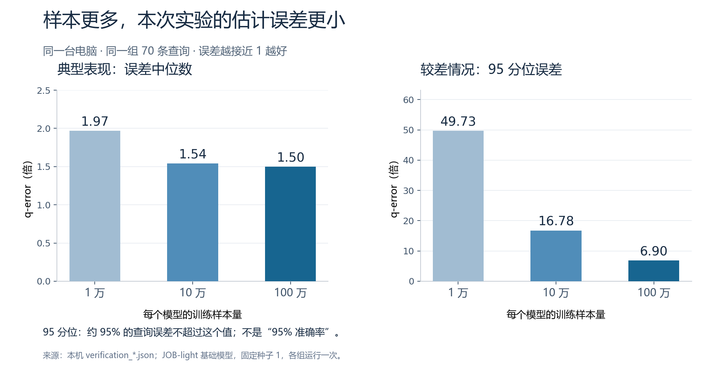
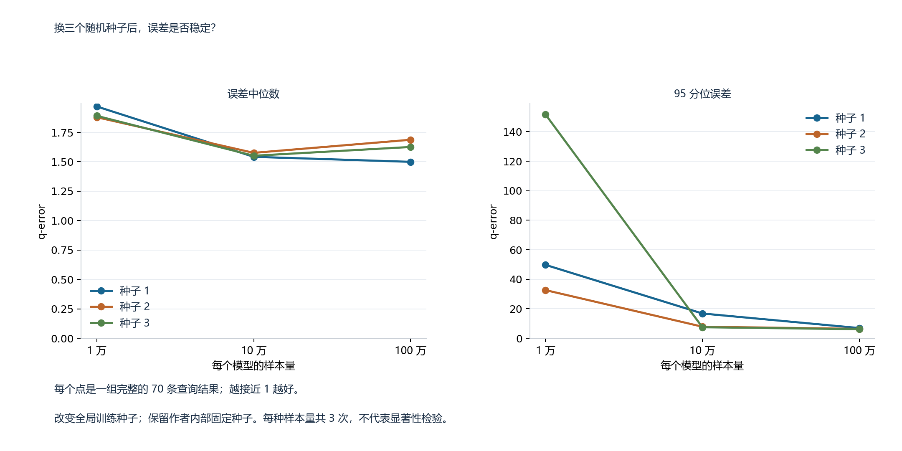
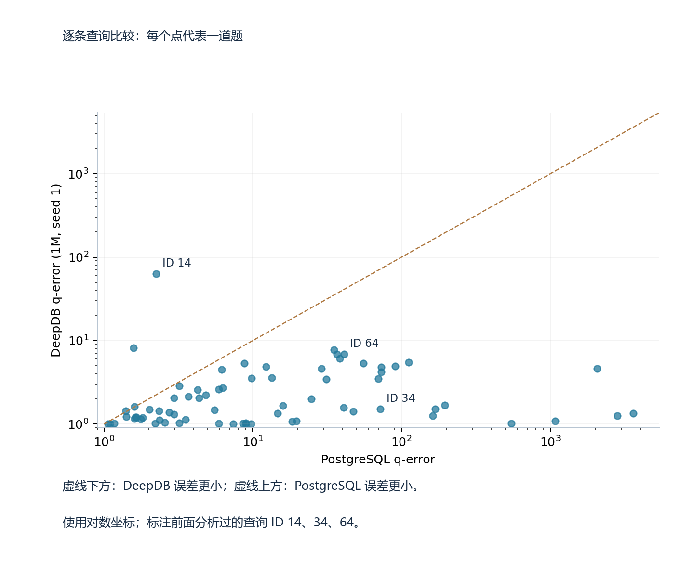
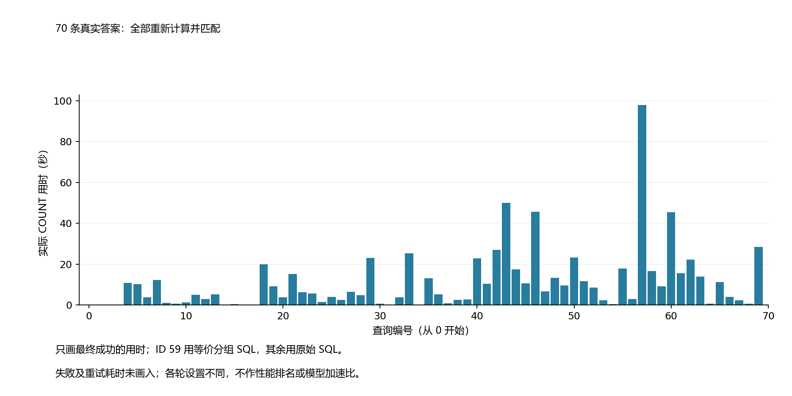
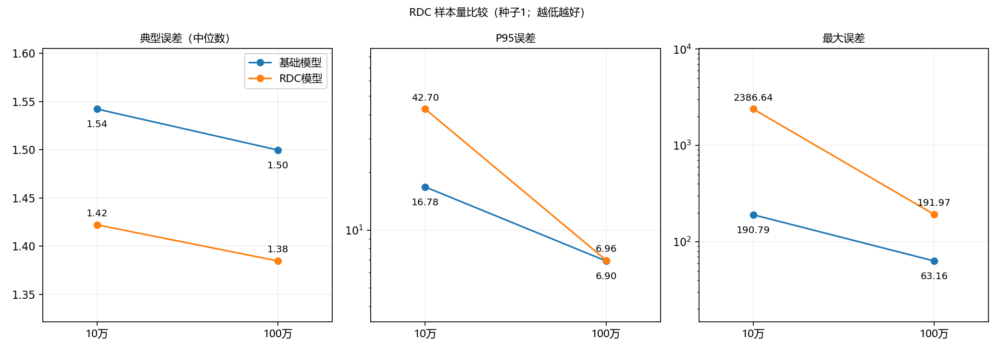
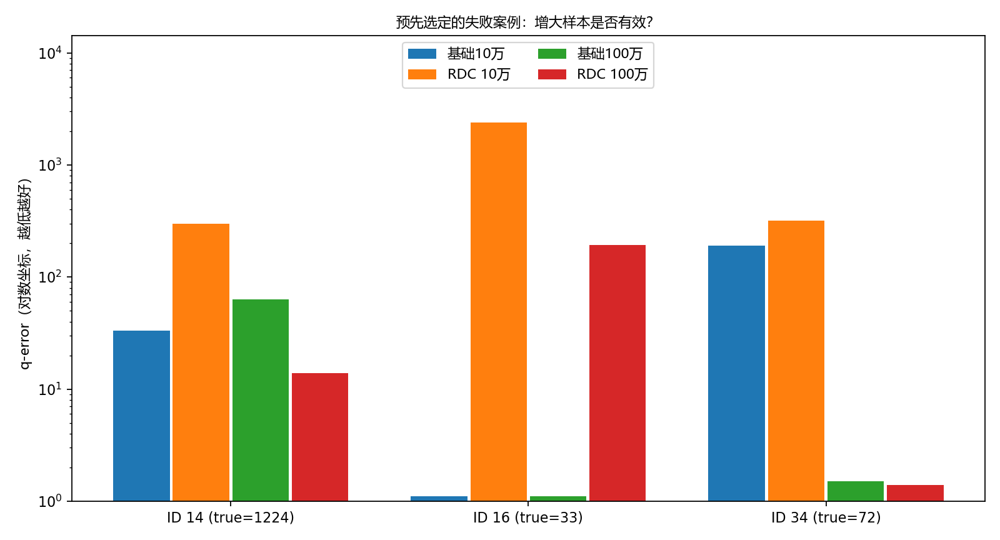

# JOB-light 实验结果与分析

本报告按已有实验组织：9轮基础模型训练、4轮RDC训练，加1组PostgreSQL估计。所有设置使用同一套70条查询；以下8类图的中英文版本对应相同实验，不增加实验数量。

## 1. 样本量：给模型更多数据会怎样？

图中为种子1的基础关系模型。样本量从1万增加到10万、100万时，中位q-error约为1.97、1.54、1.50，P95约为49.73、16.78、6.90。这轮总体改善，但不能推断每条查询都会改善。

## 2. 重复种子：结论是否依赖一次抽样？

基础模型包含3种样本量×3个全局种子，共9轮。1万到10万时三轮中位误差均改善；10万到100万时两个种子的中位误差反而略高，但P95三轮均改善。因此“更多样本更好”需要分别看指标。

## 3. PostgreSQL：传统数据库对照

PostgreSQL的中位q-error为8.6874，P95为842.7846。同样百万样本、种子1的基础DeepDB对应1.4997和6.9010，70条查询中66条误差更低。图中的其他DeepDB样本量也均为种子1。第二张图每个点是一条查询，虚线下方表示DeepDB误差更小。这里只比较基数估计准确度，不证明实际SQL执行提速。

## 4. 真值：70条正确答案重新核验

保存的重算计数与官方答案70/70一致：69条原始SQL直接成功，ID59采用等价精确分组计数，且在另外4条原始SQL实算结果上交叉核对。下图只展示最终成功尝试的耗时，未计失败重试；各轮设置不同，ID59的SQL写法也不同，所以它是过程记录，不能据此做查询性能排名或模型加速比。具体记录见truth_audit.csv，ID59的SQL见README。

## 5. RDC：增加训练样本的影响

固定种子1和同一份预采样、RDC值及表组合，把每模型样本从10万提高到100万：RDC中位误差1.4221→1.3847，P95为42.6988→6.9630，最大误差2386.6428→191.9660。尾部明显改善，但仍需和对应基础模型比较。RDC每轮7个模型，基础模型5个，训练总量并不相同。

## 6. 具体查询：有改善，也保留失败案例

这里分析ID14、16、34（编号从0开始）。下表可由predictions.csv直接重算，使用种子1。ID16真值仅33，RDC百万样本估计仍约0.172，误差约192倍；它的失败没有被整体中位数的改善掩盖。ID14和34在百万样本RDC下则较对应基础模型更准。这些是查看结果后的探索性案例分析，不是独立泛化测试。

| ID | True | Baseline 100K q | RDC 100K q | Baseline 1M q | RDC 1M q |
|---|---:|---:|---:|---:|---:|
| 14 | 1224 | 33.4660 | 297.0273 | 63.1645 | 13.8650 |
| 16 | 33 | 1.1083 | 2386.6428 | 1.1111 | 191.9660 |
| 34 | 72 | 190.7942 | 318.5461 | 1.5054 | 1.3908 |

## 7. RDC三种子：中位数改善是否重复出现？

| Seed | Baseline median | RDC median | Baseline P95 | RDC P95 | Baseline max | RDC max |
|---|---:|---:|---:|---:|---:|---:|
| 1 | 1.4997 | 1.3847 | 6.9010 | 6.9630 | 63.1645 | 191.9660 |
| 2 | 1.6874 | 1.4322 | 6.3468 | 3.8232 | 33.0000 | 223.7538 |
| 3 | 1.6261 | 1.4446 | 6.1186 | 8.6999 | 33.0000 | 664.0056 |

RDC分别有42、44、42条更准，中位误差三轮都更低；P95只在一轮更低，最大误差三轮都更大。典型查询改善在本设置下重复出现，但困难查询仍不稳定。三轮固定同一份1万行预采样，部分作者内部种子也固定；全局种子变化会影响RDC搜索、模型选择与训练，不能当成所有随机源完全独立的重复。

## 8. 范围与复核

这些材料记录13轮模型训练和1组数据库估计；仍只有70条不同查询。作者核心算法沿用，本次不声称核心算法重新实现或论文全部复现。两条模型流程的连接规模来源不同，不能把所有差异只归因于RDC。训练时间来自历史运行，不做严格速度对比。完整日志、模型、数据与重训练入口保留在本机；本目录提供结果展示和离线数值核验。

在仓库根目录运行：`python output/results/guoao_experiments/verify_results.py --repo-root .`。实验设置见[settings.json](settings.json)，指标见[metrics.csv](metrics.csv)，逐条预测见[predictions.csv](predictions.csv)。
